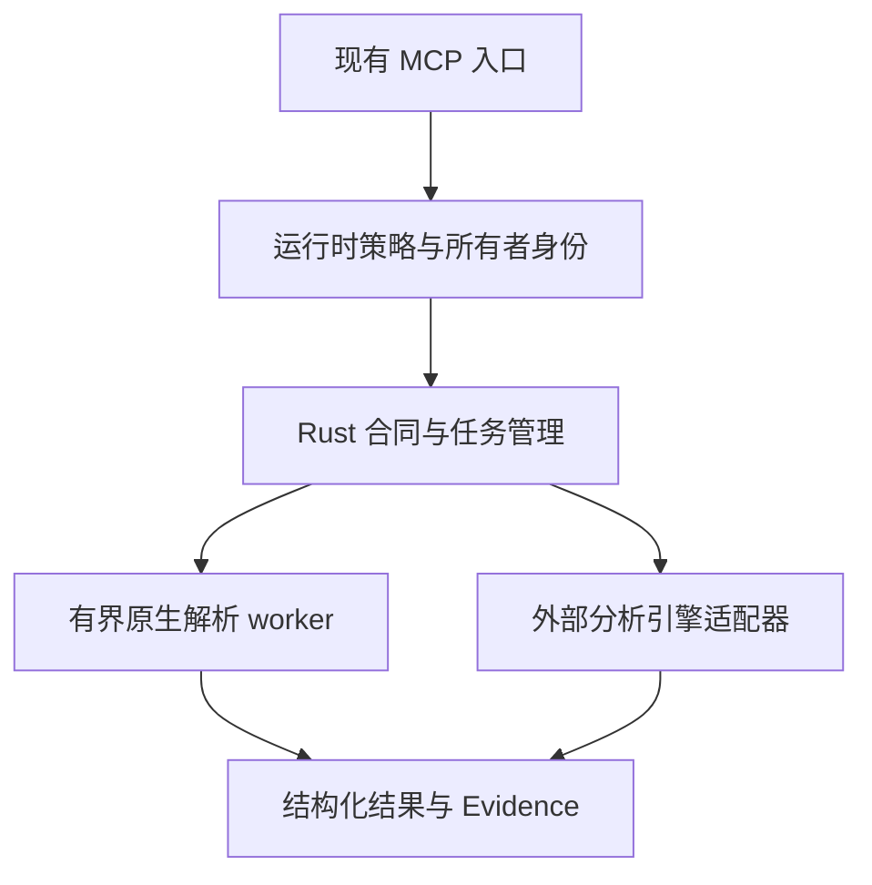

# REA 纳入 HeptaRuntime：Rust 原生实现、验收与剩余工作

日期：2026-11-04。本文记录独立工作分支上的实际实现和验证，不代表已部署或已完成全部 REA 兼容性。

## 1. 结论与当前状态

**REA 的编排层、合同层和适合原生处理的静态分析能力可以直接用 Rust 纳入 HeptaRuntime；目前已有实际代码和真实 MCP 验证支持这条路线。完整替代 REA 的全部能力尚未完成。**

当前冻结的兼容目标是 npm `rea-agents@6.8.0` 的 **229 个工具、18 个来源族**。HeptaRuntime 当前发现 **26 个原生 `rea_*` MCP 接口**。逐项映射为 **18 项部分操作、23 项相关设施、188 项尚无对应操作**；通过完整上游合同资格认证的工具为 **0**，严格账本仍是 **229 OPEN**。26 个本地接口与 229 个上游工具并非一一对应，不能用两者相除得到迁移完成率。

本轮已经实现或修复的具体问题包括原生 Source Map、ASAR 与 ASAR 内 JavaScript 获取、APK 签名记录验证、Evidence 十进制中点舍入，以及 Source Map 运行时策略注册遗漏。完整 Rust 矩阵和原 21 组 Python 矩阵均已通过；具体范围与最终交付状态见后面的记录。此前的失败日志均保留，没有通过改写账本、放宽生产约束或增加测试重试次数来宣称闭合。

完整 REA 替代还有大量实际工程工作。外部引擎发现、有限样本成功、纯 Rust 的数据解析和一个上游工具完整兼容，分别代表不同证据强度。本文把它们单独列出，避免将部分实现或有限验收描述成全部 blocker 已闭合。

## 2. 应如何集成

### 2.1 直接纳入原有 runtime

REA 的能力入口应接入 HeptaRuntime 已有的策略、主机选择、所有者身份、任务生命周期、取消、恢复和保留结果体系。新增的原生操作已经沿着这条路径实现：工具注册进入现有 MCP server，解析和分析逻辑进入 Rust 模块，需要强制终止与资源约束的工作进入受控 worker。无需为这些能力再建立独立 REA daemon、监督器或恢复账本。



适合纳入 Rust 的部分包括输入合同、分页与类型化结果、内容身份、资源预算、静态格式解析、受控执行、Evidence 规范化、持久化引用和取消恢复。它们能共享 HeptaRuntime 的已有基础设施，减少多套身份、任务和错误语义之间的转换。

### 2.2 外部引擎仍是明确依赖

重写 REA 的 TypeScript 层，并不会同时重写 Ghidra、JADX、Chrome、Frida、ADB 或模型后端。可采用 Rust 适配器控制这些引擎，把运行身份、输入摘要、输出边界、停止与恢复统一到 runtime 中；是否继续使用某个引擎，是对应操作的合同和工程选择。

本轮新增的 Source Map、ASAR、APK 验证及相应 JavaScript 获取路径不需要在生产中执行 Node。开发验证仍使用真实 REA、Babel、Electron ASAR 工具或 Android 签名工具作为独立参考。现有 durable launcher、部分远程辅助路径和通用模型后端仍保留 Python。**“这些新增路径是 Rust 原生”不等于“整个 HeptaRuntime 已完全移除 Python”。**

REA 上游采用 MIT 许可；集成时应保留适用的版权和许可信息，并分别处理外部引擎、依赖及测试材料的许可。上游主项目许可不能替代这些依赖的独立许可审查。固定 npm 包的 package.json 实际声明仓库为 [morluto/rea](https://github.com/morluto/rea)、license 为 MIT；包内 LICENSE 为 1064 bytes，SHA-256 `798f9e4d18e49b30bf2f12696c8ced73dc4e1413da375a333d01281543a1ea8b`。这是已认证 npm 包里的许可观察，不冒充另一次 Git LICENSE blob 验证。

### 2.3 用完整合同定义兼容性

每个工具至少需要比较：输入格式及默认值、ArtifactInput 变体、错误与 unknown/partial 区别、输出字段与分页、稳定身份、Evidence、保留视图、大小和时间限制，以及适用的取消、重启与恢复行为。

本地函数计算出一个相同数值，只能证明对应投影。名称相似、输入 schema 相似、依赖引擎已经安装，均不能替代完整行为比较。当前映射生成器会拒绝手工将状态改成 PASS，并对新增或删除的原生处理器、源码摘要、映射和冻结目录进行一致性检查。

## 3. 冻结目标与身份

| 项目 | 固定身份 |
| --- | --- |
| 已发布上游包 | `rea-agents@6.8.0`；229 工具，18 个族 |
| npm 压缩包 SHA-256 | `8d542ec76a9cb350584b60a6c9c088706ff812d5bb5b094c20c95b6dc25698bb` |
| 分别固定的上游 Git 源码 | `93b8b82db70279e40f484114cff9dc1958dc14ee`；234 个静态声明 |
| 当前生产、测试及脚本源码基准 | `ed74d9dbf04b97fad38112c2ac08127bf99b3590` |
| 当前 release SHA-256 | `aa580409a73bc2e0927ead93d32634239051a39fc951c3c2a92d5a1dece8347a` |
| 当前 release 大小 | 18,437,864 bytes |
| release 与 Rust 矩阵的 641 文件内容清单摘要 | `4021ee22efdf2eac830e08afc45eddf37b264e7fd31a222c329b4950ef2d94b6` |
| 继续工作的历史本地基准 | `1d9ea7e7e7a1625c611d5f6e037a1ed9d57379d4` |
| 此前已发布 PR 头 | `310add6db47bcfbed3545432eb528a72f5eb6dcd` |

npm 发布内容和 Git 源码是两种不同身份。五个仅存在于固定 Git 静态声明中的名称为 `guided_workflows`、`inspect_android_jni_bindings`、`read_guidance_section`、`reset_investigation`、`search_guidance`。它们不应加入 npm 的 229 项分母，也不能据此声称已经执行过一个 234 工具的 Git 构建。

源码冻结后加入的验收档案、说明和报告是文档提交。最终交付提交与生产源码基准因此可以不同；恢复包的 manifest 单独记录最终 HEAD 和 Git tree。上表的 641 文件摘要是自定义内容清单摘要，不是 Git tree ID。其他验收使用不同的源码选择集，保留其各自定义和摘要，不能混用。

## 4. 本轮新增及修复的原生能力

### 4.1 Source Map

新增 `rea_inspect_source_map` 及其原生 worker，支持普通及内嵌 indexed v3 Source Map 的有界解析、声明检查和点位查询。实现包含受检 VLQ 数值、累计位置约束、重复位置的稳定处理、跨行 GLB 及嵌套 section 偏移处理。

主要边界为：8 MiB JSON、16,384 个 source/name、256 个 section、嵌套深度 8、100 万行、20 万 segment、1 MiB 响应和 256 条分页；worker 采用 2 个并发槽、768 MiB 地址空间、12 秒 CPU 预算和 20 秒 wall deadline。

实际 REA 对照覆盖 **8 个 fixture、217 个查询**。独立 `trace-mapping` 参考有 **7 个直接一致样本**；另一个嵌套偏移样本保留真实分歧：该 consumer 返回列 13，原生实现与实际 REA 返回列 4。第八个 golden 来自独立编写的展平等价 map。没有把这个分歧涂成八个直接一致样本。相关偏移规则见 [ECMA-426](https://tc39.es/ecma426/)。

公开 MCP 的 7 个原门验证输入身份、取消、原 worker 回收和恢复等条件。五秒取消观察界限、二十秒 worker deadline 均保持原值。二十秒从源码捕获完成后的 worker 阶段开始；正在执行的本地文件读取仍是协作式捕获，不能据此承诺整个请求的硬时限，也没有证明任意 Rust future 被直接丢弃时的通用安全性。

本轮完整测试还发现 `rea_inspect_source_map` 未加入 runtime-only 名称集合。实际修复是补齐生产注册；普通目录仍准确暴露原有十个工具。新增回归检查从真实处理器注册发现所有 REA 接口，逐一核对 runtime-only 集合，避免再由手工数量掩盖遗漏。

仍未实现完整 `trace_web_source_location` 合同、URL 获取及解析、浏览器 import-map 和完整应用追踪。

### 4.2 ASAR 与 JavaScript 获取

新增 `rea_inspect_asar`、`rea_read_asar_member`，并把显式选中的 ASAR 成员接入原生 JavaScript 图分析。生产路径直接读取归档，不执行 Node，不解包并执行目标程序。

实现验证头部、成员 extent、选择成员的分块及整体 SHA-256、有限范围读取，并明确拒绝不支持的链接及 unpacked 路径。边界包括 16 MiB 头部、50,000 个条目、32 层深度、64 KiB 范围读取、64 MiB 被选成员校验，以及每份 1 MiB、合计 4 MiB 的 JavaScript 源码。

新 release 的原计划 **7/7 命令**通过。ASAR 独立生产器部分为 **8/8 fixture、24 个范围、55 个探针，其中 23 个为预期拒绝**；取消观察为 **0.031425591 秒**，从确认停止 worker 起的 deadline 观察为 **20.035755374 秒**。原生 JavaScript 与 Babel/手工 golden 对齐 **17 imports、16 exports、12 个 Electron 调用点、4 条 IPC 候选边**；JS 取消为 **0.031014685 秒**，同 owner 可恢复。

JS 的这一原始验收计划只有单独取消分支，没有单独执行二十秒 deadline 分支；不能把配置里存在 deadline 字段当作已完成该门。静态 IPC 候选边也不是运行时 IPC 的证明。

原生 ASAR 的 header 摘要覆盖完整 Pickle header，与 Electron JSON header 摘要的范围不同。结果保留 `publisher_authenticated=false`，未提供全归档摘要时保留 unknown；成员内容一致不能推导出发布者认证。参见 [Electron ASAR integrity](https://www.electronjs.org/docs/latest/tutorial/asar-integrity)。

### 4.3 APK 签名记录验证

新增 `rea_inspect_apk_signature` 及独立 worker。Rust 验证 APK v2/v3 的受支持签名记录、整个 APK 的 1 MiB chunk SHA-256/SHA-512 摘要、EOCD 相关重写规则、算法记录顺序、叶证书 DER/SPKI 一致性及 v3 SDK 字段复制关系。

已支持的算法路径包括 RSA-PSS / PKCS#1 配合 SHA-256/512，以及明确支持的 ECDSA 组合。输入上限为 128 MiB，签名块 16 MiB，响应 1 MiB；worker 使用 2 个槽、1 GiB 地址空间、20 秒 CPU 和 30 秒 wall deadline。此次实现沿用已有 Rust 依赖，`Cargo.toml` 与 `Cargo.lock` 未改变。

实际三方参考验证覆盖 **20 个 fixture 加 4 个畸形 worker 输入**，并对实际 REA 安装包的 **2398 个文件**与固定 npm 压缩包逐一核实。20 个样本包括 19 个 Android 正例和一个摘要匹配但签名伪造的负例。33 bit RSA 指数通过；34 bit 合法指数超出当前 `ring` 支持范围时返回 partial/unsupported，同时保留摘要与 SPKI 观察，不伪报 invalid。

公开 MCP 的 **6/6 生命周期门**通过：取消为 **0.021748459 秒**；配置为三十秒的 deadline，从请求开始观察为 **32.369054655 秒**，从停止 worker 观察为 **30.626186646 秒**，均按原五秒取消、三十五秒 deadline 观察门判定。原 worker 被回收，同 owner 恢复、冷重启和两个 controller 的正常 EOF 均有原始记录，没有计入手工 worker 清理。

映射已纠正为专用的上游 `inspect_apk_signature`。通用平台 `inspect_signature` 仍是 absent，不能因本地能解析 APK 就视为已实现。Android apksigner、Java 和 Bouncy Castle 在这里是开发验证参考，不是这个原生静态读取器的生产依赖。

结果明确保留 `complete_android_verification=false` 与 `rea_evidence_compatible=false`。尚缺冻结上游合同中的原始 v1 signer/certificate、相关 v3.1 rotation 观察、ArtifactInput、类型化结果、完整 Evidence 及保留视图。完整 Android 安装信任、v4 等属于另行未主张的能力，不能自动扩大成这个固定静态合同的必需门。规范来源：[APK v2](https://source.android.com/docs/security/features/apksigning/v2)、[APK v3](https://source.android.com/docs/security/features/apksigning/v3)。

### 4.4 Evidence 数字规范化

修复了一个可重现的十进制中点舍入问题。对 IEEE-754 bits `431548edc45ad881`，旧输出为 `1497790137415200.3`，ECMAScript 参考为 `1497790137415200.2`。沿用现有 `serde_json` / `zmij` 依赖，新增具体回归检查。

历史 418 样本没有覆盖本次发现的中点情形。新的 438 样本加入 20 个 tie case，当前 aa580 release 经实际 npm Evidence / public MCP 对照为 **438/438，零 mismatch**。开发阶段另对 **1,052,304 个有限数值**完成广泛对照，零 mismatch；该开发实验与当前 release 的 438 样本重放分开存证，不能说百万样本已重新跑在当前 release 上。

数字规范化是 Evidence 的一部分。它不能替代操作语义、身份图、父子关系、导入导出、保留视图和恢复的完整合同验证。

## 5. 最终功能验收

### 5.1 完整 Rust 和 Python 矩阵

| 检查 | 实际结果 | 重要范围 |
| --- | --- | --- |
| `cargo fmt --all -- --check` | 通过 | 原格式门 |
| Clippy，all-features / all-targets | 通过 | `-D warnings`，locked/offline |
| Clippy，no-default-features / all-targets | 通过 | 相同严格门 |
| Rust nextest，all-features | **1933 run / 1933 passed / 40 skipped** | 一线程、零重试、无 fail-fast、忽略 default filter |
| Rust nextest，no-default-features | **1906 run / 1906 passed / 28 skipped** | 相同条件 |
| 原 Python 矩阵 | **21/21 组，441/441 tests，0 skipped** | 原 exact argv，串行执行 |
| 全缓存映射认证 | 通过，exit 0，VERIFIED_AGAINST_PINS | 认证冻结原始输入与映射一致性 |
| 离线映射检查 | 通过，exit 0，NOT_REVERIFIED | 不重新认证 npm 原始压缩包 |
| 严格完整兼容门 | 预期退出 3 | 229 OPEN；预期拒绝不能计为 parity PASS |

Rust 使用 Cargo/rustc 1.95.0、nextest 0.9.137，四个构建 job，两个 feature 配置分别运行。源码、测试、脚本和配置共 641 个被选文件在运行前后字节一致；两份 inventory 原始 JSON 的 SHA-256 均为 `a906c7844ea2641fd331768c40437b5aafa2656c33874ea494744f87990c64f2`，监控零事件、零错误。完整 r3 summary SHA-256 为 `17be4f0ba0bf74098f47446445efbc85241b762c562118caa35cdd7da7883280`。

40/28 个 skipped 保留 nextest 原策略；不把 ignored/provider tests 或 doctests 计为通过。两个 feature 模式有重叠测试，也不把 1933 + 1906 称为不同功能的数量。

Python 在 Rust 和六组外部任务真实完成后运行，保留原来 21 组命令；其 1109 文件源码选择集额外包括 `deploy` 和 `tools`；与 Rust 641 文件的交集逐项一致。前后内容摘要均为 `3a2a3c8ecb68d58688326f84aea084a8dcf8a4e7344c7c14897b12d95cfb557d`，零变更事件。Python summary SHA-256 为 `02ebbdaf7974e8903229b8764a00b7fb5c06f20e423887723db7de1ac6a63e41`。它与 Rust 的 641 文件选择不同，不应拿两个摘要是否相等判断源码是否发生变化。

| Python 组 | 测试数 |
| --- | ---: |
| file_capabilities | 9 |
| runtime_registry_page_tests | 29 |
| test_native_canary_resume | 10 |
| chatgpt_v11_layered_read_tests | 23 |
| chatgpt_v11_process_start_concurrency_tests | 15 |
| chatgpt_v11_v4_session_binding_tests | 14 |
| runtime_workflow_owner_tests | 15 |
| chatgpt_v10_single_v4_effect_tests | 8 |
| chatgpt_v10_stream_custody_tests | 18 |
| test_computer_http | 19 |
| full_operator_facade_tests | 31 |
| full_operator_cancel_tests | 26 |
| chatgpt_request_identity_tests | 21 |
| full_operator_session_recovery_tests | 17 |
| rea_browser_capture_tests | 22 |
| rea_compatibility_ledger_tests | 27 |
| native_rollout_tests | 15 |
| recover_control_channel_tests | 24 |
| x230-20261028 | 57 |
| x230-20261029 | 6 |
| x230-20261030 | 35 |
| **合计** | **441** |

### 5.2 原资源条件下的外部引擎验证

Chrome 有 **11 项原生检查、10 组选择性 Python 参考对照、6 项预期 deadline 检查**；Ghidra 有 **8 项真实引擎检查**。最终重验使用原始资源 profile：Chrome 400% CPU、4 GiB、nice 10、1200 秒监督上界；Ghidra 400% CPU、8 GiB、nice 10、1200 秒。两个任务串行，均 exit 0、无超时、原输出完整且持久。

中间一次 aa580 引擎运行虽功能通过，却遗漏外层资源限制并发生重叠；该次记录完整保留，不用于证明原 profile 下合格。修正后的 profile 真实重跑成功，所用四份 harness 内容不变。

Chrome 的验收对象是受控 HTTP 资源、保存的 HAR 表示和相应读取/比较，尚不等于任意页面 DOM 或完整网络 wire 等价。Ghidra 使用 12.2/JDK 25、operator 模式和有限输入；取消后的一个私有 scratch 目录由 harness 删除，不能写成 runtime 自行完成所有清理。此验收不建立通用隔离执行或完整 provider parity。

## 6. 失败与修复过程必须一起保留

| 原始问题 | 处理和证据 | 仍需保留的限制 |
| --- | --- | --- |
| Source Map 注册遗漏 | 将真实处理器加入 runtime-only 集合；普通目录十工具不变；新增按注册发现的全体 REA 检查 | 修复策略暴露不等于完整上游工具实现 |
| intent-publication fixture 在共享临时父目录绑定 audit | 测试改用私有 audit/events.jsonl，确定性制造父目录变化；原 ext4 环境取得 RED，再取得 10 项 start_io + 14 项 publication GREEN | 原生产 audit 检查、真实 sync 和时限不变；历史那一次脱敏错误不能唯一确定瞬间原因 |
| Rust r2 四个 SSH fixture 在两个 feature 下失败 | 记录完整失败；按 OpenSSH 路径预算采用独占短 TMPDIR，再跑完整 r3 | 原生产 90-byte guard 不变；不通过删断言解决 |
| Python r1 canary 发生十秒超时 | 保留 440 pass + 1 error；先做未修改代码的 ext4 诊断，再按原 21 命令串行完成当前 441 pass | 原历史超时根因未被证明；当前 tmpfs 功能通过不等于 ext4 聚合延迟问题已归因或修复 |
| 缓存路径指向不完整目录 | 首次最终 mapping 的 cached 检查实际返回 2，离线检查为 0、严格门为 3；保留原失败，再改用已有经过认证的完整缓存重验 | 没有改动 MAP、LEDGER 或脚本；正确缓存认证见最终档案 |
| 准备目录冲突、错误 summary 字段或缺少 runner | 保留准备任务的失败和测试执行数零；使用新的独占准备目录后才开始真实验收 | 不能算作产品测试失败，也不能计为通过 |
| 引擎外层 profile 遗漏 | 保存错误 profile 的功能记录，再按原限制和顺序重新运行 | 两次记录独立，不将前次回填成原资源条件 |

首次 Rust r1 实际为 all-features **1930 pass / 2 fail / 40 skip**，no-default **1904 pass / 1 fail / 28 skip**。修复后 r2 的对应数字为 **1929/4/40** 和 **1902/4/28**，四个失败均为路径预算。最终 r3 才是 **1933/0/40** 与 **1906/0/28**。每一轮各自使用零自动测试重试；这不隐瞒进行过有明确变更原因的三轮矩阵。

路径预算有静态证明和完整失败日志。Linux `sun_path` 108 bytes，扣除 OpenSSH 临时发布的 17 bytes 后缀和终止 NUL，生产路径上限为 90。当前 fixture 在七位 PID 与完整二十位 u64 序号下需要 `L + 53 + 7 + 20`，因此临时目录编码长度应不超过 10。独占创建的 `/dev/shm/q` 满足该约束，并验证 UID、0700、实际 tmpfs、可执行和无 symlink；没有修改全局挂载、现有目录权限或生产校验。

手工 retired fixture 最后使用 `UnixListener::bind` 直接绑定，不经过 OpenSSH 临时发布路径。相同最坏组合为 104 bytes，未超过其 107-byte 最终路径范围。这两个边界不能混为一个公式。

当前 Rust/Python 矩阵是记录在案的 Linux 功能 profile 验收。其意义是原测试、原时限和固定源码在该 profile 中全部执行通过；它不证明掉电持久性、任意磁盘负载延迟或跨平台完整性。

## 7. 完整兼容性为何仍然 OPEN

### 7.1 当前逐项清单

| 映射状态 | 项数 | 能证明什么 |
| --- | ---: | --- |
| partial_operation | 18 | 实际有一部分对应操作，仍缺完整合同或完整资格证据 |
| related_facility | 23 | 有可复用设施，但尚不是那个上游操作 |
| absent | 188 | 当前没有对应操作实现 |
| qualified | 0 | 尚未有一个工具完成完整上游合同认证 |
| OPEN | 229 | 全部工具的完整兼容门仍未闭合 |

当前 26 个原生接口按设施分组如下；worker 和 CLI 辅助入口另行计数。

| 设施 | 原生 MCP handler |
| --- | --- |
| 制品、归档、应用 | `rea_inspect_artifact`、`rea_inspect_archive`、`rea_inspect_application` |
| ASAR | `rea_inspect_asar`、`rea_read_asar_member` |
| 模型与模型会话 | `rea_inspect_model`、`rea_read_model`、`rea_model_session_open`、`rea_model_session_list`、`rea_model_session_query`、`rea_model_session_read` |
| JavaScript / Source Map | `rea_inspect_javascript_package`、`rea_inspect_javascript_graph`、`rea_inspect_source_map` |
| APK 签名 | `rea_inspect_apk_signature` |
| Web capture | `rea_inspect_web_capture`、`rea_compare_web_captures`、`rea_replay_web_entry` |
| Preview | `rea_retain_preview`、`rea_read_preview` |
| 静态分析控制 | `rea_static_profiles`、`rea_static_start`、`rea_static_status`、`rea_static_read`、`rea_static_cancel` |
| Evidence | `rea_verify_evidence` |

18 项部分操作的精确名称为：

`inspect_model_artifact`、`inspect_gpu_code_objects`、`list_procedures`、`procedure_info`、`procedure_references`、`procedure_pseudo_code`、`xrefs`、`inspect_macho`、`list_architectures`、`inspect_artifact`、`inspect_with_objdump`、`inspect_android_package`、`inspect_binary_layout`、`inspect_elf_notes`、`inspect_apk_signature`、`trace_web_source_location`、`inspect_web_network_capture`、`analyze_javascript_application`。

冻结目录的族计数为：direct 41、enhanced 15、native 32、artifact 23、managed 7、firmware 2、android 5、pcap 2、flutter 2、frida 9、apktool 2、jeb 4、adb 24、browser 12、electron 6、javascript-runtime 2、application 18、session 23，合计 229。来源族是原始分类，不直接对应工程工作量。

### 7.2 仍缺的实际工程

1. **Evidence、Artifact 与视图合同。** 需要完整 export/import/get、稳定身份关系、父子及 selectors、分页、保留和恢复，以及每个操作的规范 Evidence 和类型化 outcome。当前数字规范化与局部身份比较不足以覆盖这些工作。
2. **完整静态语义。** JavaScript 仍需 dataflow、call/return、closure、稳定 IDs 与完整应用图；Android、Apple、Harmony、managed 应用图及 CLR/CIL 的覆盖也不完整。通用 classes/methods/refs、模型类型和布局、批量反编译的选择与覆盖合同需分别实现。
3. **实时会话及引擎控制。** Frida、Rizin、ADB、浏览器、Electron 等需要操作级 owner、permissions、attach/cancel、重连和恢复验证。能发现设备或启动一次引擎不能关闭这些门。
4. **Firmware/PCAP 的精确观察。** 应使用上游已有受控 generator 与独立字节/offset oracle，完成 producer 输出、类型化错误、原始偏移和 Evidence 的真实比较。固定上游已有相应 corpus 生成源码，这不是“完全没有样本”的阻塞。
5. **完整行为资格 runner。** 当前目录/映射生成器不执行全部 229 个工具的独立行为比较。要真正减少 OPEN，需有一个绑定输入、实现及引擎身份的 runner，为每个 gate 保存真实证据，然后由受检资格流程产生 passed gates。

工程次序建议是先补跨操作共享的 Artifact/Evidence/view/outcome 合同，再选 `inspect_elf_notes`、`inspect_apk_signature`、`inspect_binary_layout` 等边界较清楚的静态工具做完整端到端资格闭环；随后扩展 JavaScript/managed/application 图，再处理有副作用的 live session 和外部 provider 矩阵。这个次序是依赖分析得出的建议，并不是虚构的完成日程。

### 7.3 环境事实与真实未知项

已有 ADB server 观察到物理设备和模拟器，因此不能把“缺 Android 硬件”列成已证明的全局 blocker。本轮没有借机对这些设备执行 attach、启动 daemon 或选择一个真实用户应用。

Ghidra 12.2、JDK 25、JADX 目录、Chrome/Chromium 和 GNU 工具已有观察；其中有限的 Chrome/Ghidra profile 已实际运行合格。对 JEB、Frida、TShark、Binwalk、Unblob 等，仅在限定 PATH/目录观察中未找到，不能外推为所有主机都不存在。**JEB 的许可证状态是 NOT_PROBED，不是已确认缺许可证。**

跨平台、隔离执行、长期 live session 恢复和完整 provider 行为仍需实际资格证据。上述未知项有的需要找到并验证环境，有的需要先补代码；不能统一归咎于环境权限。

## 8. 交付、发布与恢复的边界

所有改动在独立工作分支 `work/rea-continuation-20261104-r2` 中完成。没有重启或切换共享生产服务，没有把这个开发 release 部署为生产默认。

报告采样时，[PR #84](https://github.com/TrillionniumFoundation/hepta-runtime/pull/84) 仍为 open/draft，远端 head 为 `310add6db47bcfbed3545432eb528a72f5eb6dcd`，base 为 `e1eb14ae8eff2fc2c3565a86a36b10dd44eac915`。此前普通 push 返回 GitHub 403 / account suspended。最终候选会按原凭据执行普通、非 force 的发布尝试；该次实际结果与最终提交身份由交付 metadata 记录。如果仍被拒绝，本地验收不能代替该最终 head 及 prospective merge 的远端 CI，也不会用其他身份绕过账号限制。

交付区分两种包。用户主机上的完整离线包包含已发布的 310 基座对象、原 1d9 增量 bundle、本轮最终增量 bundle 和完整源码清单；便携下载包包含全部未发布增量及清单、恢复脚本，明确要求调用者已有包含 310 及其正确 tree 的仓库。完整基座 pack 为 121,489,675 bytes，经当前连接实测传输需数小时，因此不把它重复放入便携增量下载。便携包不宣称能在缺少基座的空机器上独立恢复。完整源码由可恢复的 Git 对象承载，避免再重复存放同内容的源码 tar。基座在 310 处明确为 shallow，不包含更早父历史；它提供恢复当前分支需要的完整基座 tree/blob 对象，而非虚构一份完整历史克隆。

完整包的最终恢复验证从新的空 bare 仓库开始，在不访问网络、不共享 alternates 或对象硬链接的条件下导入整条链，核对每个 bundle 的实际 prerequisite 与 advertised refs，再核对最终 commit/tree，并执行完整 `git fsck`。便携包另从显式给定的既有基座创建新的独立 bare 仓库后导入增量，并核对同一最终源码清单。两条恢复流程分别保存真实结果，恢复脚本均拒绝覆盖已有目标目录。最终交付附录给出实际完成状态和文件身份。

源码清单从 `git ls-tree` / `git cat-file` 的真实对象字节生成，逐文件核对路径、模式、类型、blob 和内容 SHA-256，恢复后再按清单验证。因此不依赖 `git archive` 的 export-ignore/export-subst 行为。最终 manifest 记录实际包内文件摘要、大小、最终 HEAD/tree 和恢复结果；可从恢复的 Git 仓库检出完整源码。

恢复包不包含用户凭据、运行时 owner 数据库、完整 npm/Cargo 缓存、外部分析引擎安装或生产环境。完整包可从空仓库恢复提交与源码；便携包依赖正确的既有 310 基座。两者均不承诺在完全无依赖缓存的新机器上离线完成编译。完整包不提供 310 以前的历史；便携恢复所用既有仓库原本具备的历史可由该仓库提供。需要完整历史时，应在有权限后从原仓库补齐该 shallow 边界。

## 9. 证据索引与复核入口

以下路径均位于交付的源码树中；每个档案自己的 README、manifest、原始日志及摘要共同定义其证据范围。

| 证据 | 源码树中的路径 |
| --- | --- |
| 冻结输入、语义映射、229 项生成账本 | `docs/rea-native/compatibility/` |
| 当前 release 构建与 Source Map | `docs/qualification/rea-final-source-map-release-20261104-r3/` |
| 当前 ASAR/JavaScript 七门 | `docs/qualification/rea-asar-javascript-final-release-20261104-r3/` |
| 当前 Evidence / APK 三组门 | `docs/qualification/rea-final-independent-release-20261104-r3/` |
| 当前 Chrome/Ghidra 原 profile | `docs/qualification/rea-final-engine-regressions-20261104-r3/` |
| r1 真实 Rust/Python 失败及诊断 | `docs/qualification/rea-continuation-matrix-failures-20261104-r1/` |
| intent fixture 的 ext4 RED/GREEN | `docs/qualification/rea-job-intent-audit-fixture-20261104-r1/` |
| r2/r3 Rust、Python 和路径预算 | `docs/qualification/rea-corrected-rust-python-matrix-20261104-r3/` |
| 最终映射与来源审计 | `docs/qualification/rea-corrected-final-mapping-20261104-r3/` |
| 本报告 | `docs/rea-native/NATIVE_CONTINUATION_20261104.md` |

映射检查可在仓库根目录复核：

```sh
python3 -B tests/rea_compatibility_ledger_tests.py -v
python3 -B scripts/rea_compatibility_ledger.py check-mapping
python3 -B scripts/rea_compatibility_ledger.py check-mapping --require-parity
```

最终 cached/offline/strict 三条原检查实际返回 0/0/3，summary SHA-256 为 `442c3df0d8efc83ba576384a533cb90175d28dc50160c4372f0d94f40af19b51`。当前第三条预期返回 3；若返回 0，必须有新的、可核对的完整行为资格证据，而不能仅修改状态字段。需要重新认证 npm/Git 原始输入时，还应使用 `check --cache /absolute/verified-cache`，并保留固定 INPUTS 的身份。

**本轮交付的是一组已实现、经完整本地功能矩阵及专项真实参考验证的 Rust 原生增量，以及完整可追溯的未闭合清单。所有 229 个 REA 工具完整兼容、全部 blocker 清零和最终生产切换，均未被本轮结果证明。**
